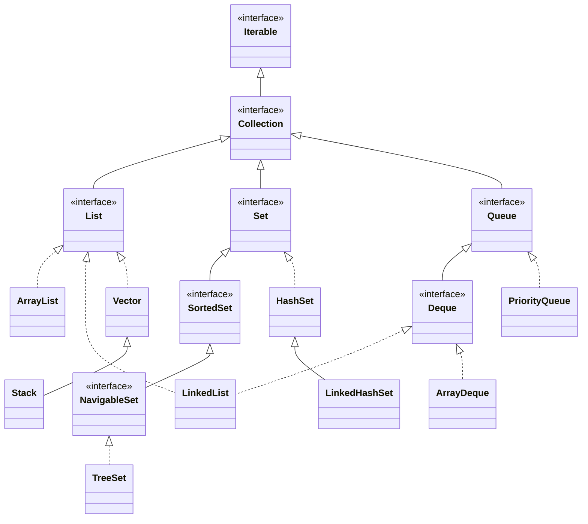
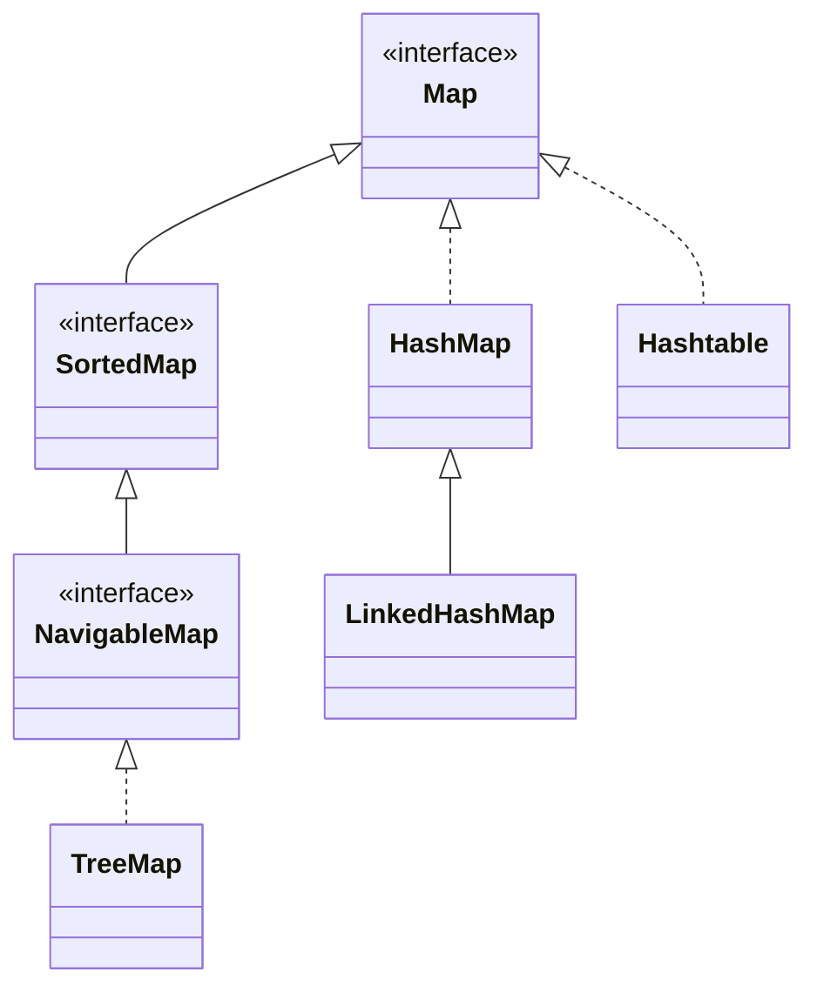
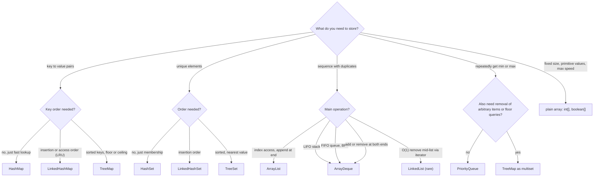

# Collections: Overview & Hierarchy

> **Level:** Easy · **Part 1 of 16** in Java Collections
>
> **TL;DR**: About 90% of DSA needs five classes: `ArrayList` (dynamic array), `HashMap`/`HashSet` (O(1) lookup), `ArrayDeque` (stack + queue + deque), `PriorityQueue` (heap) and `TreeMap`/`TreeSet` (sorted, floor/ceiling in O(log n)).
> Declare with the interface type (`List<Integer> list = new ArrayList<>()`). Never use `Stack`, `Vector` or `Hashtable`.

---

## What is a "collection"? (plain English)

An **array** is a row of lockers bolted to the wall: you pick how many when you build it and you can never add one more.

A **collection** is a smart container *object*. It grows and shrinks by itself and comes with ready-made operations: "do you contain X?", "give me the smallest", "remove the oldest", "what's the value for this key?".

Java splits every container into two parts:

| Part | What it is | Example | Analogy |
|---|---|---|---|
| **Interface** | the *contract*: what you can do | `List` promises "ordered, index access". `Set` promises "no duplicates". `Map` promises "key → value". | "a vehicle that can drive" |
| **Implementation class** | the *engine*: how it's done | `ArrayList` uses an array, `LinkedList` uses linked nodes | car, bike, bus |

Same contract, different speed. Choosing a collection = choosing the engine whose fast operations match what your algorithm does most.

---

## The four families

| Family | Promise | Duplicates? | Order | Classes you'll use |
|---|---|---|---|---|
| **List** | a sequence you can index | yes | insertion / index | `ArrayList`, (`LinkedList`) |
| **Set** | each element at most once | no | none / insertion / sorted | `HashSet`, `LinkedHashSet`, `TreeSet` |
| **Queue / Deque** | process in a fixed order: FIFO, LIFO or by priority | yes | depends | `ArrayDeque`, `PriorityQueue` |
| **Map** | key → value lookup | keys no, values yes | none / insertion / sorted | `HashMap`, `LinkedHashMap`, `TreeMap` |

## The four engines inside

Every class above is built on one of four internal designs. Once you know the engine, you know the speed.

| Engine | Classes | Fast at | Slow at |
|---|---|---|---|
| **Resizable array** | `ArrayList`, `ArrayDeque`, `PriorityQueue` | index access, adding at the end | inserting / removing in the middle, searching |
| **Linked nodes** | `LinkedList` | adding / removing at the ends | index access, memory |
| **Hash table** | `HashMap`, `HashSet`, `LinkedHashMap`, `LinkedHashSet` | add / find / remove by key: O(1) | anything about order, "nearest" queries |
| **Red-black tree** | `TreeMap`, `TreeSet` | sorted order, floor / ceiling, min / max: O(log n) | plain lookup (log n, not 1) |

---

## The hierarchy

### Collection side



### Map side (Map does NOT extend Collection)



Solid arrows (`<|--`) mean "extends". Dotted arrows (`<|..`) mean "implements". `LinkedList` implements **both** `List` and `Deque`. `Iterable` is what makes the for-each loop work.

---

## Basic rules

```java
import java.util.*;

List<Integer> list = new ArrayList<>();      // program to the interface
Map<String, Integer> map = new HashMap<>();  // diamond <> infers the types
Deque<Integer> stack = new ArrayDeque<>();
Queue<Integer> q = new ArrayDeque<>();
// List<int> bad;                            // compile error: generics need objects
```

**Why the interface type on the left?** If you later swap `ArrayList` for `LinkedList`, only the right side changes. It also stops you from accidentally calling methods that only one engine has.

**Why `Integer` and not `int`?** Generics only hold objects. Java converts automatically (`int` → `Integer` is *boxing*, back is *unboxing*). The cost: each `Integer` is a separate object of about 16 bytes plus a 4-byte reference, versus 4 bytes for an `int` in an `int[]`. That's why a plain `int[]` beats `ArrayList<Integer>` in tight loops.

---

## Master complexity table

Average case. `n` is the size. "amort." means amortised (cheap on average over many calls, see [Amortized Analysis](/notes/cx-amortized)).

| Class | add / put | get / access | contains | remove | Iteration order | Null allowed | Thread-safe |
|---|---|---|---|---|---|---|---|
| `ArrayList` | O(1) amort. at end, O(n) at index | O(1) by index | O(n) | O(n); O(1) at end | insertion / index | yes | no |
| `LinkedList` | O(1) at ends, O(n) at index | O(n) by index, O(1) ends | O(n) | O(1) ends or via iterator, O(n) by value | insertion | yes | no |
| `ArrayDeque` | O(1) amort. at both ends | `peekFirst/Last` O(1) | O(n) | O(1) at ends, O(n) by value | head to tail | **no** (NPE) | no |
| `PriorityQueue` | `offer` O(log n) | `peek` O(1) | O(n) | `poll` O(log n), `remove(obj)` O(n) | **not sorted** (heap array) | **no** (NPE) | no |
| `HashSet` | O(1) | n/a | O(1) | O(1) | unpredictable | one `null` | no |
| `LinkedHashSet` | O(1) | n/a | O(1) | O(1) | insertion | one `null` | no |
| `TreeSet` | O(log n) | `first`/`last`/`floor` O(log n) | O(log n) | O(log n) | sorted | **no** (NPE) | no |
| `HashMap` | O(1) | O(1) | key O(1), value O(n) | O(1) | unpredictable | one `null` key, `null` values | no |
| `LinkedHashMap` | O(1) | O(1) | key O(1), value O(n) | O(1) | insertion (or access order) | one `null` key, `null` values | no |
| `TreeMap` | O(log n) | O(log n) | key O(log n), value O(n) | O(log n) | sorted by key | no `null` keys, `null` values OK | no |
| `Vector` / `Stack` / `Hashtable` | legacy | | | | | | yes (synchronized, slow) |

Worst cases: `HashMap`/`HashSet` degrade to O(log n) per bucket once a bucket becomes a red-black tree (Java 8+), and to O(n) with a terrible `hashCode` and non-`Comparable` keys. Resizing is O(n), but amortised O(1).

---

## Which collection should I use?



| Problem smell | Reach for |
|---|---|
| "count occurrences", "frequency" | `HashMap<K, Integer>` or `int[26]` |
| "seen before?", "duplicate?" | `HashSet` |
| "k largest / smallest", "k closest" | `PriorityQueue` of size k |
| "next greater element", "matching brackets" | `ArrayDeque` as a (monotonic) stack |
| "shortest path in unweighted graph", "level order" | `ArrayDeque` as a queue |
| "sliding window max/min" | `ArrayDeque` monotonic deque |
| "closest value <= x", "intervals overlap?" | `TreeMap` / `TreeSet` |
| "recently used", "evict oldest" | `LinkedHashMap` |
| "group by some key" | `HashMap<K, List<V>>` + `computeIfAbsent` |
| "running median" | two `PriorityQueue`s |
| "weighted shortest path" | `PriorityQueue<int[]>` (Dijkstra) |

---

## Path through this section (easy → hard)

| # | Note | Level | You'll learn |
|---|---|---|---|
| 1 | Overview & Hierarchy (this note) | Easy | the map of everything |
| 2 | [ArrayList](/notes/coll-arraylist) | Easy | dynamic arrays, capacity vs size |
| 3 | [LinkedList](/notes/coll-linkedlist) | Easy | nodes, and why you rarely need it |
| 4 | [ArrayDeque: Stack & Queue](/notes/coll-arraydeque) | Easy | circular buffers, BFS, monotonic stack |
| 5 | [Utilities, List.of & Conversions](/notes/coll-utilities) | Easy | `Collections`, immutable lists, array ↔ list |
| 6 | [HashMap](/notes/coll-hashmap) | Medium | hashing, buckets, resize, treeify |
| 7 | [HashSet & LinkedHashSet](/notes/coll-hashset) | Medium | sets built on maps |
| 8 | [Map Idioms](/notes/coll-map-idioms) | Medium | merge, compute, sort by value |
| 9 | [LinkedHashMap & LRU](/notes/coll-linkedhashmap) | Medium | order-keeping hash maps |
| 10 | [Iterators & Traps](/notes/coll-iteration-traps) | Medium | `ConcurrentModificationException`, boxing traps |
| 11 | [equals, hashCode & Custom Keys](/notes/coll-custom-keys) | Medium | making your own keys work |
| 12 | [PriorityQueue (Heap)](/notes/coll-priorityqueue) | Medium | heaps, top-K, Dijkstra |
| 13 | [TreeMap & TreeSet](/notes/coll-treemap) | Hard | red-black trees, floor / ceiling |
| 14 | [Internals I: Arrays, Deques & Heaps](/notes/coll-internals-arrays) | Hard | build ArrayList, ArrayDeque, heap yourself |
| 15 | [Internals II: HashMap & TreeMap](/notes/coll-internals-maps) | Hard | build a hash map and a balanced tree |
| 16 | [Hard Use Cases](/notes/coll-hard-cases) | Hard | LRU, LFU, sliding median, skyline … |

**Next:** [2. ArrayList](/notes/coll-arraylist)
