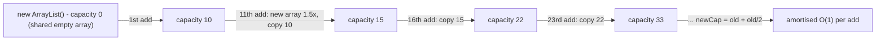

# ArrayList

> **Level:** Easy · **Part 2 of 16** in Java Collections
>
> **In one line:** a normal array that quietly moves itself into a bigger array when it fills up. O(1) to read any index, O(1) (amortised) to add at the end, O(n) to insert or delete anywhere else.

---

## In plain English

Picture a row of numbered seats in a small hall. Anyone can walk straight to seat #57 (that's **O(1) index access**). New people sit in the next empty seat at the end (cheap).

When the hall is full, the manager books a hall **1.5 times bigger** and walks everyone over, keeping their seat numbers. That move is slow, but it happens rarely, so averaged over all arrivals it's still cheap. That's what "**amortised O(1)**" means.

If someone wants to sit at seat #0, everybody has to shift one seat to the right: **O(n)**.

## Capacity vs size

Two numbers live inside every `ArrayList`:

| | Meaning | You can see it? |
|---|---|---|
| **size** | how many elements you've added | `list.size()` |
| **capacity** | how many slots the hidden array has | no (internal) |

`size <= capacity` always. When `size == capacity` and you add, the list grows.

---

## How it works inside

```java
// Simplified from java.util.ArrayList (JDK 17+)
public class ArrayList<E> {
    transient Object[] elementData;   // the hidden array (the "hall")
    private int size;                 // seats in use

    public boolean add(E e) {
        modCount++;                                     // remembered for iterators, see note 10
        if (size == elementData.length) elementData = grow(size + 1);
        elementData[size++] = e;
        return true;
    }

    private Object[] grow(int minCapacity) {
        int old = elementData.length;
        if (old == 0 && elementData == DEFAULTCAPACITY_EMPTY_ELEMENTDATA)
            return new Object[Math.max(10, minCapacity)];          // first add: capacity 10
        int newCap = old + Math.max(minCapacity - old, old >> 1);  // old + old/2  = 1.5x
        return Arrays.copyOf(elementData, newCap);                 // O(n) copy
    }

    public E remove(int index) {
        E old = (E) elementData[index];
        int moved = size - index - 1;
        System.arraycopy(elementData, index + 1, elementData, index, moved);  // shift left
        elementData[--size] = null;                    // let the garbage collector free it
        return old;
    }
}
```



Facts worth knowing:

- `new ArrayList<>()` allocates **nothing** until the first `add`, then makes room for 10.
- Growth is **1.5x** (`old + old >> 1`). Each grow is an O(n) copy, but the copies add up to at most about 3n for n adds, so each add costs O(1) on average.
- The list **never shrinks** by itself. `remove` only lowers `size`. `trimToSize()` shrinks the array to fit.
- Removed slots are set to `null` so the removed object can be garbage-collected.
- `new ArrayList<>(100_000)` pre-sizes the array, so no grows happen at all.

---

## The API you'll actually use

```java
List<Integer> list = new ArrayList<>();
List<Integer> sized = new ArrayList<>(100_000);          // pre-size to skip the resizes
List<Integer> copy  = new ArrayList<>(Arrays.asList(3, 1, 2)); // mutable copy

list.add(10);                 // append O(1) amortised
list.add(0, 5);               // insert at index 0: O(n) shift
list.get(1);                  // 10, O(1)
list.set(1, 99);              // replace, O(1), returns the old value
list.size();                  // not length / length()
list.isEmpty();
list.contains(99);            // O(n) linear scan
list.indexOf(99);             // first index or -1, O(n)
list.lastIndexOf(99);
list.remove(list.size() - 1); // remove the LAST element: O(1), pop-like
list.remove(0);               // remove the FIRST element: O(n) shift!
list.addAll(List.of(7, 8));
list.clear();

Collections.sort(list);                        // ascending (TimSort, stable)
list.sort(null);                               // same thing
list.sort(Comparator.reverseOrder());          // descending
list.subList(1, 3);                            // VIEW of [1, 3), not a copy
list.subList(1, 3).clear();                    // removes the range from the original list
Collections.reverse(list);
Collections.swap(list, 0, 1);

// Iterate
for (int x : list) { }                          // auto-unboxing
for (int i = 0; i < list.size(); i++) list.get(i);

// 2D: list of lists (the standard LeetCode return type)
List<List<Integer>> res = new ArrayList<>();
res.add(new ArrayList<>(List.of(1, 2)));
res.get(0).add(3);
```

Java 21 added `list.getFirst()`, `list.getLast()`, `list.removeLast()` and `list.reversed()`. They're nice, but `get(0)` and `get(size() - 1)` work on every judge.

### Backtracking: the "copy the path" rule

```java
void backtrack(int[] nums, int start, List<Integer> path, List<List<Integer>> res) {
    res.add(new ArrayList<>(path));            // COPY. res.add(path) would store the same list n times
    for (int i = start; i < nums.length; i++) {
        path.add(nums[i]);                     // choose     O(1)
        backtrack(nums, i + 1, path, res);
        path.remove(path.size() - 1);          // un-choose  O(1): removing the last element shifts nothing
    }
}
```

---

## Complexity

| Operation | Time | Why |
|---|---|---|
| `get(i)`, `set(i, x)` | O(1) | address = start + i × slot size |
| `add(x)` at end | O(1) amortised, O(n) worst | an occasional grow copies everything |
| `add(i, x)`, `remove(i)` | O(n − i) | shift everything after `i` |
| `remove(size() - 1)` | O(1) | nothing after it to shift |
| `contains`, `indexOf`, `remove(Object)` | O(n) | linear scan with `equals` |
| `sort` | O(n log n) | TimSort, stable, O(n) on already-sorted input |
| `subList(a, b)` | O(1) | returns a view, copies nothing |

---

## Use in DSA

The default "dynamic array": result lists, adjacency lists (`List<List<Integer>>`), a backtracking path, buckets in bucket sort, building an answer whose size you don't know in advance.

## Pitfalls

- **`list.remove(x)` with an `int`** removes by *index*. Use `list.remove(Integer.valueOf(x))` to remove by value. (More in [Iterators & Traps](/notes/coll-iteration-traps).)
- **`list.remove(0)` in a loop** is O(n²) overall. Use an `ArrayDeque` if you keep taking from the front.
- **`list.contains(x)` in a loop** is O(n²). Keep a `HashSet` next to the list.
- **`res.add(path)`** in backtracking adds a reference; later changes to `path` change every stored "copy". Add `new ArrayList<>(path)`.
- **`subList` is a view.** Changing the parent list's size afterwards makes the view throw `ConcurrentModificationException`.
- **`Arrays.asList(...)` and `List.of(...)`** are fixed-size / immutable. Wrap with `new ArrayList<>(...)` before adding.
- **Forgetting `new ArrayList<>()` per adjacency slot** causes an NPE on `adj.get(u).add(v)`.

**Next:** [3. LinkedList](/notes/coll-linkedlist)
