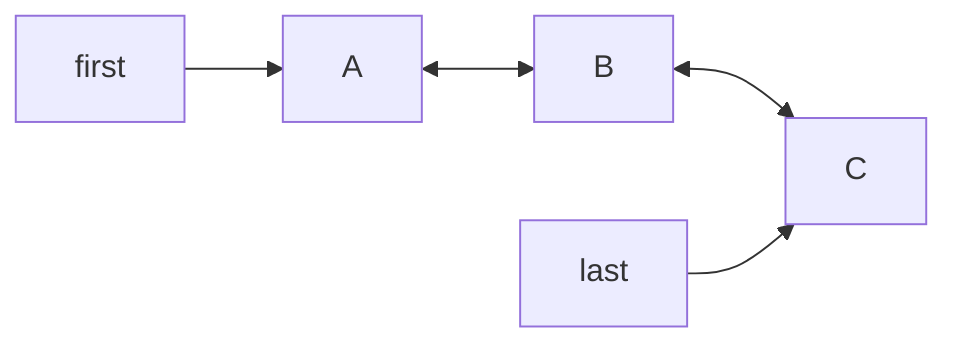

# LinkedList

> **Level:** Easy · **Part 3 of 16** in Java Collections
>
> **In one line:** a chain of nodes where each node knows the one before and after it. O(1) at both ends, O(n) to reach the middle. In DSA you almost always want `ArrayDeque` or `ArrayList` instead.

---

## In plain English

Think of a train. Every coach is coupled to the coach in front and the coach behind. Adding or removing a coach at either end is instant: uncouple, couple. But to find coach #500 you have to walk through the train coach by coach.

An `ArrayList` is the opposite: like seats numbered in a hall, you jump straight to seat #500, but inserting a seat in the middle means everyone shuffles.

---

## How it works inside

```java
// Simplified from java.util.LinkedList
public class LinkedList<E> {
    private static class Node<E> {
        E item;
        Node<E> next;
        Node<E> prev;
    }
    transient Node<E> first;   // head
    transient Node<E> last;    // tail
    transient int size;

    void linkLast(E e) {                       // add / addLast / offer: O(1)
        Node<E> l = last;
        Node<E> n = new Node<>(); n.item = e; n.prev = l;
        last = n;
        if (l == null) first = n; else l.next = n;
        size++;
    }

    Node<E> node(int index) {                  // used by get(i), set(i), add(i, x), remove(i)
        if (index < (size >> 1)) {             // closer to the front: walk forwards
            Node<E> x = first;
            for (int i = 0; i < index; i++) x = x.next;
            return x;
        } else {                               // closer to the back: walk backwards
            Node<E> x = last;
            for (int i = size - 1; i > index; i--) x = x.prev;
            return x;
        }
    }
}
```



What that means:

- `addFirst` / `addLast` / `removeFirst` / `removeLast`: change a couple of pointers, **O(1)**.
- `get(i)`: walks from the nearer end, up to n/2 steps, **O(n)**.
- **Memory**: each node is an object with a header and three references, about **24 bytes** on a 64-bit JVM, plus the boxed element. An `ArrayList` slot is **4 bytes**. Nodes are also scattered around memory, so the CPU cache helps much less.

---

## The API

```java
LinkedList<Integer> ll = new LinkedList<>();
ll.addFirst(1);      ll.addLast(2);       // O(1)
ll.getFirst();       ll.getLast();        // throw if empty
ll.peekFirst();      ll.peekLast();       // null if empty
ll.removeFirst();    ll.removeLast();     // throw if empty
ll.pollFirst();      ll.pollLast();       // null if empty
ll.add(1, 42);                            // O(n) walk + O(1) link
ll.get(5);                                // O(n): never in a loop!

// O(1) removal/insertion while walking: use a ListIterator
ListIterator<Integer> it = ll.listIterator();
while (it.hasNext()) {
    int v = it.next();
    if (v % 2 == 0) it.remove();          // O(1): the iterator already stands on the node
    else it.add(v * 10);                  // insert after the current node, O(1)
}
```

---

## LinkedList vs ArrayList

| | `ArrayList` | `LinkedList` |
|---|---|---|
| `get(i)` | **O(1)** | O(n) |
| add / remove at end | O(1) amortised | O(1) |
| add / remove at front | O(n) | **O(1)** |
| insert in middle by index | O(n) shift | O(n) walk + O(1) link |
| remove during iteration | O(n) shift each | **O(1)** via iterator |
| memory per element | ~4 bytes (+ boxed value) | ~24 bytes (+ boxed value) |
| cache friendliness | excellent | poor |
| allows `null` | yes | yes |

"Linked lists are fast at inserting in the middle" is only true **if you are already standing on that node**. Inserting by index first has to walk there, which is O(n) anyway, and `System.arraycopy` in an `ArrayList` is so fast that the array usually wins in practice.

---

## Use in DSA

Rarely. Prefer `ArrayDeque` for stacks and queues. `LinkedList` is only needed when you must store `null` in a queue, or need O(1) removal through an iterator.

LeetCode linked-list problems use their own `ListNode` class, not `java.util.LinkedList`. The *ideas* here (prev/next pointers, sentinels) matter a lot there, and in hand-built LRU caches (see [Hard Use Cases](/notes/coll-hard-cases)).

## Pitfalls

- **`ll.get(i)` inside a `for` loop** is O(n²). Use a for-each loop or an iterator.
- **`remove()` / `element()` / `getFirst()` on empty** throw `NoSuchElementException`. `poll()` / `peek()` return `null`.
- **`LinkedList` as a `List` and a `Deque` at once** can confuse: `remove()` removes the head, `remove(int)` removes by index, `remove(Object)` by value.

**Next:** [4. ArrayDeque: Stack & Queue](/notes/coll-arraydeque)
