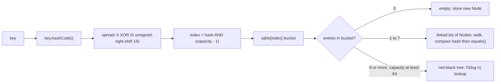
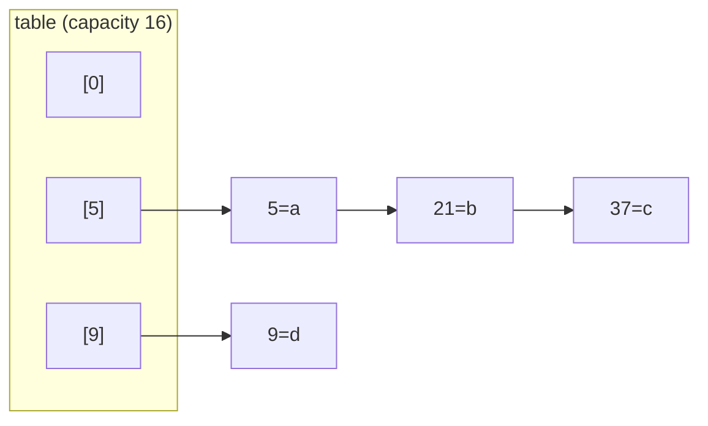

# HashMap

> **Level:** Medium · **Part 6 of 16** in Java Collections
>
> **In one line:** turns a key into an array index with a formula (the *hash*), so put / get / remove are O(1) on average. No order. The most used class in DSA after `ArrayList`.

---

## In plain English

Imagine a cloakroom with 16 numbered hooks. When you hand in a coat, the attendant doesn't search for a free hook; they run your ticket name through a fixed formula ("add up the letters, take the remainder by 16") and get a hook number, say 7. Next time you ask for your coat, the same formula gives 7 again, so they walk straight to hook 7. That's **O(1)**.

- The formula is the **hash function**.
- The hooks are **buckets** (slots of an array).
- Two names can give the same hook number: a **collision**. Both coats then hang on hook 7 in a short chain, and the attendant checks each one's name tag (`equals`).
- When the cloakroom gets 75% full, they move to a room with **twice** as many hooks and re-hang every coat (**resize**). Rare and slow, so O(1) on average.

---

## How it works inside

The real storage is `Node<K,V>[] table`. Each node is `{ hash, key, value, next }`.



### Step 1: hashCode → spread hash

```java
static final int hash(Object key) {
    int h;
    return (key == null) ? 0 : (h = key.hashCode()) ^ (h >>> 16);   // mix the high bits into the low bits
}
```

**Why the XOR?** With 16 buckets only the lowest 4 bits pick the bucket. Keys whose hash codes differ only in high bits (e.g. `0x10000`, `0x20000`, `0x30000`) would all land in bucket 0. Folding the top 16 bits down spreads them to buckets 1, 2, 3.

### Step 2: hash → bucket index

```java
int index = hash & (table.length - 1);    // same as hash % length, because length is a power of two
```

The capacity is **always a power of two** (16, 32, 64 …) so `length - 1` is all ones in binary (`15 = 0b1111`), and `&` just keeps the low bits. That's faster than `%` and never negative.

### Step 3: put

1. Table not created yet? Create it with 16 slots (it's lazy).
2. Bucket empty? Put a new node there. Done.
3. Otherwise walk the bucket. For each node, check `node.hash == hash` (cheap int compare) and then `node.key == key || key.equals(node.key)`. Match → **replace the value**, return the old one.
4. No match → append a new node at the end of the chain. If the chain now has 8+ nodes, turn it into a red-black tree (or resize instead if the table is smaller than 64).
5. `if (++size > threshold) resize();`

`get` is the same walk without the insert.

### A concrete example

`Integer.hashCode()` is the number itself, so with capacity 16:

| Key | `key & 15` | Bucket |
|---|---|---|
| 5 | 5 | 5 |
| 21 | 21 = 16 + 5 → 5 | 5 |
| 37 | 37 = 32 + 5 → 5 | 5 |

All three collide: bucket 5 holds the chain `5 → 21 → 37`.



### Step 4: resize (capacity × 2)

When size passes `capacity × 0.75`, a table twice as big is allocated and every node is moved. Java 8 does this cleverly: with the new capacity 32, a node either **stays** at index `i` or **moves** to `i + 16`, decided by one bit (`hash & 16`):

| Key | `hash & 16` | New bucket |
|---|---|---|
| 5 | 0 | stays at 5 |
| 21 | 16 | moves to 5 + 16 = **21** |
| 37 | 0 | stays at 5 |

So each old chain splits into a "low" and a "high" chain, keeping the order. No hash is recomputed.

### Key numbers

| Parameter | Value | Meaning |
|---|---|---|
| Default capacity | 16 | always a power of two, so `& (n-1)` works like `% n` |
| Load factor | 0.75 | resize when `size > capacity * 0.75` (threshold 12 at the start, so the 13th put resizes) |
| Resize | capacity x 2 | moves all entries: O(n), amortised O(1) per put |
| `TREEIFY_THRESHOLD` | 8 | bucket list becomes a red-black tree |
| `UNTREEIFY_THRESHOLD` | 6 | tree shrinks back to a list |
| `MIN_TREEIFY_CAPACITY` | 64 | below this it resizes instead of treeifying |

Why 0.75? A trade-off: lower wastes memory, higher makes chains longer. At 0.75 a bucket has 0 or 1 entries over 90% of the time.

### Pre-sizing correctly

`new HashMap<>(100)` does **not** mean "100 entries without a resize". It rounds up to capacity 128, whose threshold is 96, so the 97th put still resizes. To hold `n` entries with no resize:

```java
Map<Integer, Integer> m = new HashMap<>((int) (n / 0.75f) + 1);
Map<Integer, Integer> m2 = HashMap.newHashMap(n);          // Java 19+, does the math for you
```

---

## The API

```java
Map<String, Integer> map = new HashMap<>();
map.put("a", 1);                    // insert or overwrite, returns the old value or null
map.get("a");                       // 1
map.get("zzz");                     // null (unboxing this into int throws an NPE!)
map.getOrDefault("zzz", 0);         // 0
map.containsKey("a");               // O(1)
map.containsValue(1);               // O(n) scan of every entry
map.remove("a");                    // returns the removed value or null
map.size(); map.isEmpty(); map.clear();

map.keySet();                       // Set<String> view (no copy)
map.values();                       // Collection<Integer> view
map.entrySet();                     // Set<Map.Entry<String,Integer>> view

for (Map.Entry<String, Integer> e : map.entrySet()) {
    String k = e.getKey(); int v = e.getValue();
}
```

Counting, grouping and the other everyday recipes are in [Map Idioms](/notes/coll-map-idioms).

---

## Complexity

| Operation | Average | Worst |
|---|---|---|
| `put`, `get`, `remove`, `containsKey` | O(1) | O(log n) with a treeified bucket of `Comparable` keys; O(n) for non-comparable keys that all collide |
| `containsValue` | O(n) | O(n) |
| iterate all entries | O(capacity + n) | |
| resize | O(n), happens rarely | |
| `clear()` | O(capacity) | the table is wiped but never shrinks |

One extra hidden cost: computing `hashCode()` and `equals()` of the key. For an `Integer` that's O(1); for a `String` of length L it's O(L) (the hash is cached after the first time), and for a `List<Integer>` key of size k it's O(k) **every** call.

---

## Use in DSA

Frequency counting, value-to-index lookup (Two Sum), prefix-sum counts (Subarray Sum Equals K), grouping (Group Anagrams), memoisation (`Map<String, Long> memo`), graph adjacency with non-integer nodes.

## Pitfalls

- **`int v = map.get(k)` for a missing key** throws an NPE (unboxing `null`). Use `getOrDefault`.
- **`map.get(k) == null`** can mean "missing" *or* "stored `null`". Use `containsKey` when nulls are possible.
- **Comparing values with `==`**: `map.get(a) == map.get(b)` compares `Integer` objects; false above 127. Use `.equals`.
- **Iteration order is unpredictable** and can change after a resize. Need order? `LinkedHashMap` or `TreeMap`.
- **Custom keys** must override both `equals` and `hashCode`, and must not change while inside the map. See [Custom Keys](/notes/coll-custom-keys).
- **The table never shrinks.** A map that once held a million entries iterates over a million-slot array even after you remove almost everything.
- **For keys `0 … n-1`, an `int[]` / `boolean[]` is 5–10x faster** than a `HashMap<Integer, …>` (no hashing, no boxing).

**Next:** [7. HashSet & LinkedHashSet](/notes/coll-hashset)
