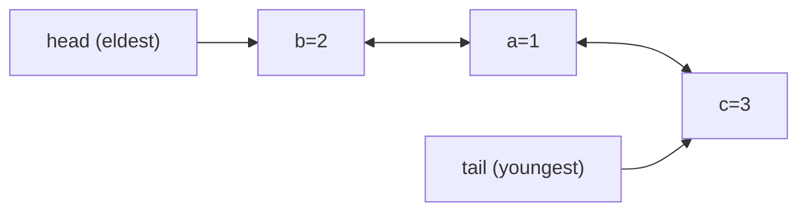

# LinkedHashMap & LRU

> **Level:** Medium · **Part 9 of 16** in Java Collections
>
> **In one line:** a `HashMap` with a doubly linked list running through its entries, so it remembers **insertion order** (or **access order**). With access order plus one overridden method it becomes an LRU cache.

---

## In plain English

A `HashMap` is a cloakroom: instant lookup, but nobody remembers who came first.

A `LinkedHashMap` is the same cloakroom with a **queue line painted on the floor** linking every coat in the order it arrived. Lookups are still instant (via the hooks), and you can also walk the line from oldest to newest.

**Access order** changes the rule: every time someone *touches* their coat (`get` or `put`), it moves to the **back** of the line. So the front of the line is always the coat that hasn't been touched for the longest time: the **least recently used** (LRU) one. A cache that throws out the front when it's full is an LRU cache.

---

## How it works inside

```java
// Simplified from java.util.LinkedHashMap
public class LinkedHashMap<K, V> extends HashMap<K, V> {
    static class Entry<K, V> extends HashMap.Node<K, V> {
        Entry<K, V> before, after;          // the painted line, on top of the bucket chain's "next"
    }
    transient Entry<K, V> head;             // eldest
    transient Entry<K, V> tail;             // youngest
    final boolean accessOrder;              // false = insertion order (default), true = access order

    // HashMap calls these "hooks" at the right moments:
    void afterNodeAccess(Node<K, V> e)   { /* if accessOrder: unlink e and relink it at tail */ }
    void afterNodeInsertion(boolean evict) {
        Entry<K, V> first = head;
        if (evict && first != null && removeEldestEntry(first)) removeNode(first.key);
    }
    void afterNodeRemoval(Node<K, V> e)  { /* unlink e from before/after */ }

    protected boolean removeEldestEntry(Map.Entry<K, V> eldest) { return false; }   // override me
}
```



All the hashing (buckets, resize, treeify) is inherited from `HashMap`; `LinkedHashMap` only maintains the extra list in those hooks. Every list update is a few pointer changes: **O(1)**. Each entry costs two more references (about 40 bytes instead of 32).

Iteration walks the linked list, not the bucket array, so it's O(n) even when the table is mostly empty.

---

## Insertion order

```java
Map<String, Integer> lhm = new LinkedHashMap<>();
lhm.put("b", 2); lhm.put("a", 1); lhm.put("c", 3);
System.out.println(lhm);              // {b=2, a=1, c=3}: insertion order
lhm.put("b", 20);                     // updating an existing key does NOT move it
System.out.println(lhm);              // {b=20, a=1, c=3}

// First Unique Character
int firstUniqChar(String s) {
    Map<Character, Integer> cnt = new LinkedHashMap<>();
    for (char c : s.toCharArray()) cnt.merge(c, 1, Integer::sum);
    for (Map.Entry<Character, Integer> e : cnt.entrySet())
        if (e.getValue() == 1) return s.indexOf(e.getKey());
    return -1;
}
```

## Access order and the LRU cache (LeetCode 146)

```java
class LRUCache extends LinkedHashMap<Integer, Integer> {
    private final int cap;
    LRUCache(int capacity) {
        super(capacity, 0.75f, true);            // accessOrder = true
        this.cap = capacity;
    }
    public int get(int key) { return super.getOrDefault(key, -1); }
    public void put(int key, int value) { super.put(key, value); }
    @Override
    protected boolean removeEldestEntry(Map.Entry<Integer, Integer> eldest) {
        return size() > cap;                     // evict the least recently used entry
    }
}
```

What happens on each call:

| Call | Inside |
|---|---|
| `get(k)` hit | HashMap finds the node in O(1) → `afterNodeAccess` moves it to the tail |
| `put(k, v)` new key | HashMap inserts the node → it's linked at the tail → `afterNodeInsertion` asks `removeEldestEntry(head)` → if over capacity, the head is removed |
| `put(k, v)` existing key | value replaced → `afterNodeAccess` moves it to the tail |

`getOrDefault` on an access-ordered `LinkedHashMap` also counts as an access, which is exactly what LRU wants. In an interview, expect to also build LRU by hand with a `HashMap` plus your own doubly linked list: see [Hard Use Cases](/notes/coll-hard-cases).

### Java 21 extras

`LinkedHashMap` is a `SequencedMap`: `firstEntry()`, `lastEntry()`, `pollFirstEntry()`, `putFirst(k, v)`, `putLast(k, v)`, `reversed()`. Handy, but not available on older judges.

---

## Complexity

| Operation | Time |
|---|---|
| `put`, `get`, `remove`, `containsKey` | O(1) average |
| eldest entry (`entrySet().iterator().next()`) | O(1) |
| move to most-recent (access order) | O(1) |
| iteration | O(n) in insertion / access order |

## Use in DSA

LRU cache, "first unique character" and other order-preserving counts, deterministic output order, and simple FIFO-eviction caches (`removeEldestEntry` with insertion order).

## Pitfalls

- **In access-order mode, `get` changes the map's structure.** Calling `get` while iterating the same map throws `ConcurrentModificationException`.
- **Updating a key in insertion-order mode doesn't move it.** Remove and re-put if you need "move to the end".
- **`removeEldestEntry` is only consulted after an insert** (`put` / `putAll` of a new key), not after `get`.

**Next:** [10. Iterators & Traps](/notes/coll-iteration-traps)
