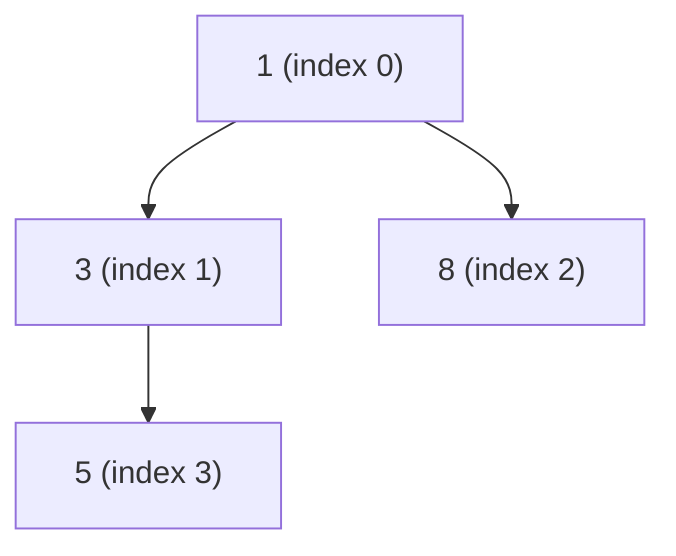

# PriorityQueue (Heap)

> **Level:** Medium · **Part 12 of 16** in Java Collections
>
> **In one line:** always hands you the smallest element (or largest, with a reversed comparator). `peek` O(1), `offer` / `poll` O(log n). Inside it is a binary heap stored in a plain array, which is why printing it doesn't look sorted.

---

## In plain English

A hospital emergency room is not first-come-first-served: the **most urgent** patient is seen next, whoever arrived first. That's a priority queue.

How does it find the most urgent patient instantly without sorting everyone? It keeps a **tournament bracket**: every "parent" is more urgent than its two "children". The champion (the minimum) is always at the top. The rest is only *partly* ordered, which is much cheaper to maintain than a fully sorted list:

- New patient? Put them at the bottom and let them **bubble up**, swapping with their parent while they're more urgent. At most one swap per level: O(log n).
- Champion leaves? Move the last patient to the top and let them **sink down**, swapping with their more urgent child. Again O(log n).

---

## How it works inside

The "tree" is not made of nodes; it is packed into an array, level by level:

| Relation | Index formula |
|---|---|
| parent of `i` | `(i - 1) / 2` |
| left child of `i` | `2i + 1` |
| right child of `i` | `2i + 2` |

```java
// Simplified from java.util.PriorityQueue
public class PriorityQueue<E> {
    transient Object[] queue;        // the heap array, default capacity 11
    int size;
    final Comparator<? super E> comparator;   // null = natural order (Comparable)

    public boolean offer(E e) {
        if (e == null) throw new NullPointerException();
        if (size >= queue.length) grow(size + 1);     // ~2x while small, 1.5x when large
        siftUp(size++, e);
        return true;
    }

    private void siftUp(int k, E x) {                  // bubble up
        while (k > 0) {
            int parent = (k - 1) >>> 1;
            Object p = queue[parent];
            if (compare(x, p) >= 0) break;             // parent already smaller or equal: stop
            queue[k] = p;                              // move parent down
            k = parent;
        }
        queue[k] = x;
    }

    public E poll() {
        if (size == 0) return null;
        E result = (E) queue[0];
        E x = (E) queue[--size];                       // take the LAST element
        queue[size] = null;
        if (size > 0) siftDown(0, x);                  // and sink it from the root
        return result;
    }

    private void siftDown(int k, E x) {                // sink down
        int half = size >>> 1;                         // nodes from 'half' on are leaves
        while (k < half) {
            int child = 2 * k + 1;
            int right = child + 1;
            if (right < size && compare(queue[right], queue[child]) < 0) child = right;  // smaller child
            if (compare(x, queue[child]) <= 0) break;
            queue[k] = queue[child];                   // move the smaller child up
            k = child;
        }
        queue[k] = x;
    }
}
```

### Walkthrough: `offer(5)`, `offer(3)`, `offer(8)`, `offer(1)`

| Step | Array | Tree |
|---|---|---|
| offer 5 | `[5]` | 5 |
| offer 3 → 3 < parent 5, bubble up | `[3, 5]` | 3 → (5) |
| offer 8 → 8 > parent 3, stays | `[3, 5, 8]` | 3 → (5, 8) |
| offer 1 → 1 < 5, then 1 < 3 | `[1, 3, 8, 5]` | 1 → (3 → (5), 8) |
| poll → returns 1; last (5) goes to the root and sinks below 3 | `[3, 5, 8]` | 3 → (5, 8) |



`System.out.println(pq)` after the four offers prints `[1, 3, 8, 5]`: the **array**, not sorted order.

### Building a heap from a collection is O(n), not O(n log n)

`new PriorityQueue<>(collection)` copies the elements and runs `heapify()`: sift down every non-leaf, from the last one up to the root. Half the nodes are leaves (0 work), a quarter sink at most 1 level, an eighth at most 2 … The total is `n · (1/4 + 2/8 + 3/16 + …) ≤ n`, so **O(n)**.

---

## The API

```java
PriorityQueue<Integer> minHeap = new PriorityQueue<>();                       // smallest at the top
PriorityQueue<Integer> maxHeap = new PriorityQueue<>(Collections.reverseOrder()); // largest at the top
PriorityQueue<Integer> maxHeap2 = new PriorityQueue<>((a, b) -> Integer.compare(b, a)); // safe
PriorityQueue<Integer> heapified = new PriorityQueue<>(List.of(5, 1, 3));      // O(n) build

minHeap.offer(5); minHeap.offer(1); minHeap.offer(3);   // add() works too
minHeap.peek();       // 1 (null if empty)
minHeap.poll();       // 1 (null if empty)
minHeap.size();
minHeap.remove(3);    // removes a specific element: O(n) search + O(log n) fix
System.out.println(minHeap);   // prints the internal heap array: NOT guaranteed sorted

// Drain in sorted order
while (!minHeap.isEmpty()) System.out.print(minHeap.poll() + " ");
```

### The `(a, b) -> b - a` overflow caveat

```java
PriorityQueue<Integer> max3 = new PriorityQueue<>((a, b) -> b - a);   // AVOID
int a = Integer.MIN_VALUE, b = 1;
System.out.println(b - a);                  // -2147483647: overflowed, says b < a (WRONG)
System.out.println(Integer.compare(b, a));  // 1 (correct)
```

It's fine when values are guaranteed small and the same sign, but `Integer.compare` / `Long.compare` is always correct. Make it a habit.

### PQ of `int[]` and objects

```java
// Sort by a[0] asc, tie-break by a[1] asc
PriorityQueue<int[]> pq = new PriorityQueue<>((x, y) ->
        x[0] != y[0] ? Integer.compare(x[0], y[0]) : Integer.compare(x[1], y[1]));

// Same thing with Comparator helpers
PriorityQueue<int[]> pq2 = new PriorityQueue<>(
        Comparator.<int[]>comparingInt(x -> x[0]).thenComparingInt(x -> x[1]));

// Objects / records
record Task(String name, int priority) {}
PriorityQueue<Task> tasks = new PriorityQueue<>(Comparator.comparingInt(Task::priority).reversed());
```

---

## Classic heap patterns

```java
// 1. K-th largest: min-heap of size k, O(n log k)
int findKthLargest(int[] nums, int k) {
    PriorityQueue<Integer> h = new PriorityQueue<>();
    for (int x : nums) {
        h.offer(x);
        if (h.size() > k) h.poll();          // throw away the smallest; the k largest remain
    }
    return h.peek();                         // the smallest of the k largest
}

// 2. Median of a data stream: two heaps
PriorityQueue<Integer> lo = new PriorityQueue<>(Collections.reverseOrder()); // max-heap, lower half
PriorityQueue<Integer> hi = new PriorityQueue<>();                           // min-heap, upper half
void addNum(int x) {
    lo.offer(x);
    hi.offer(lo.poll());                     // the biggest of the low half moves up
    if (hi.size() > lo.size()) lo.offer(hi.poll());   // keep lo the same size or one bigger
}
double findMedian() {
    return lo.size() > hi.size() ? lo.peek() : (lo.peek() + (long) hi.peek()) / 2.0;
}

// 3. Dijkstra: {node, dist}, min by dist, with lazy deletion
PriorityQueue<long[]> heap = new PriorityQueue<>((x, y) -> Long.compare(x[1], y[1]));
long[] dist = new long[n];
Arrays.fill(dist, Long.MAX_VALUE);
dist[src] = 0;
heap.offer(new long[]{src, 0});
while (!heap.isEmpty()) {
    long[] cur = heap.poll();
    int u = (int) cur[0];
    if (cur[1] > dist[u]) continue;                // stale entry: skip instead of deleting it
    for (int[] edge : adj.get(u)) {                // edge = {v, w}
        int v = edge[0];
        long nd = dist[u] + edge[1];
        if (nd < dist[v]) { dist[v] = nd; heap.offer(new long[]{v, nd}); }
    }
}
```

### No decrease-key: lazy deletion

`PriorityQueue` can't change an element's priority in place. Two options:

1. `pq.remove(obj)` then `pq.offer(updated)`: O(n), fine for small heaps.
2. **Lazy deletion** (as in Dijkstra above): push a new entry, and when an outdated one comes out of `poll`, skip it. The heap may hold up to E entries, so Dijkstra is O(E log E) = O(E log V).

---

## Complexity

| Operation | Time |
|---|---|
| `peek` | O(1) |
| `offer` / `add` | O(log n) |
| `poll` / `remove()` | O(log n) |
| `remove(Object)`, `contains` | O(n) |
| `new PriorityQueue<>(collection)` | O(n) |
| iteration / `toString` | O(n), **unsorted** |
| draining all with `poll` | O(n log n) (that's heapsort) |

## Use in DSA

Top-K, K-th largest, merge K sorted lists, Dijkstra, Prim, median of a stream (two heaps), task scheduler, meeting rooms, greedy "always take the best available".

## Pitfalls

- **Printing or iterating** is not sorted. Only `poll()` gives order.
- **`b - a` comparators** overflow on large or opposite-sign values.
- **Not stable**: equal priorities come out in no particular order. If FIFO among ties matters, add an increasing sequence number as a tie-breaker.
- **Changing an object's priority field while it's inside** corrupts the heap silently. Remove, change, re-offer.
- **`null` is rejected** (`offer(null)` throws an NPE).
- **Elements must be comparable**: a PQ of a class without `Comparable` and without a comparator throws `ClassCastException` on the first `offer` (or the second, depending on the version).

**Next:** [13. TreeMap & TreeSet](/notes/coll-treemap)
