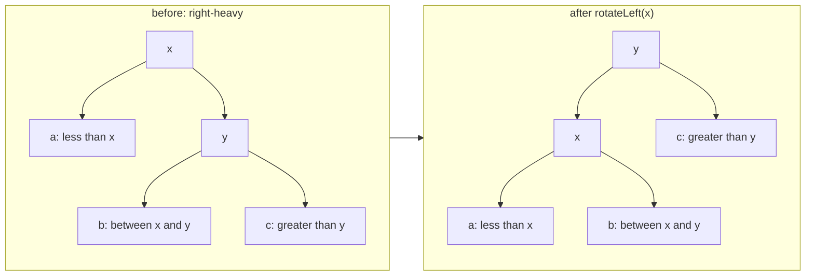

# TreeMap & TreeSet

> **Level:** Hard · **Part 13 of 16** in Java Collections
>
> **In one line:** a self-balancing binary search tree (red-black tree) that keeps keys **sorted**. Every operation is O(log n), and it answers "nearest value ≤ x / ≥ x" (`floor` / `ceiling`) instantly, which no hash structure can do.

---

## In plain English

A `HashMap` is a cloakroom: instant, but in no order. A `TreeMap` is a **dictionary**: always alphabetical, so besides "is *mango* in here?" you can ask "what's the word just before *mango*?" or "all words between *kiwi* and *pear*".

Inside it's a **binary search tree**: each node has a key; everything in its left branch is smaller, everything in the right branch is bigger. To find a key you go left or right at each node, like a guessing game ("higher / lower"), so the work is the tree's **height**.

The danger: insert 1, 2, 3, 4, 5 into a plain BST and it becomes a stick (height n, O(n) per operation). A **red-black tree** colours each node red or black and, after every insert/delete, recolours and **rotates** a few nodes to keep the height at most about 2·log₂n. A million keys → at most ~40 steps.

---

## How it works inside

```java
// Simplified from java.util.TreeMap
public class TreeMap<K, V> {
    static final class Entry<K, V> {
        K key; V value;
        Entry<K, V> left, right, parent;
        boolean color = BLACK;
    }
    private transient Entry<K, V> root;
    private transient int size;
    private final Comparator<? super K> comparator;   // null = natural order (Comparable)
}
```

### The four red-black rules (plain English)

1. Every node is red or black.
2. The root is black.
3. A red node never has a red child (no two reds in a row on any path).
4. Every path from a node down to an empty spot passes the **same number of black nodes**.

Rules 3 + 4 mean the longest path (alternating red, black, red, black …) is at most **twice** the shortest (all black). So the height is ≤ 2·log₂(n + 1): guaranteed O(log n).

### Rotations: the rebalancing move

A rotation re-hangs three nodes so a branch gets shorter while keeping the left-smaller / right-bigger order:



A new key is inserted as a normal BST leaf coloured **red**; if that breaks rule 3, `fixAfterInsertion` recolours and does at most **two rotations**. Deletion does at most three. You never write this in an interview; know *why* it's O(log n). A mini version is built in [Internals II](/notes/coll-internals-maps).

### How `floor` works

Walk down like a search; every time the current key is **smaller** than the target, remember it as the best answer so far and try to find a bigger one on the right:

```java
// Equivalent to TreeMap.getFloorEntry
Entry<K, V> floor(K key) {
    Entry<K, V> p = root, best = null;
    while (p != null) {
        int c = compare(key, p.key);
        if (c == 0) return p;                     // exact match
        if (c > 0) { best = p; p = p.right; }     // p.key < key: candidate, look for a bigger one
        else p = p.left;                          // p.key > key: too big, go left
    }
    return best;                                  // null if every key is bigger
}
```

`ceiling`, `lower` and `higher` are the same walk with the comparisons flipped. One root-to-leaf path: O(log n).

### Equality comes from the comparator

A `TreeMap` never calls `equals` or `hashCode`. Two keys are the same key when `compare(a, b) == 0`. A comparator that returns 0 for different items **silently merges them**. Always add tie-breakers. (Details in [Custom Keys](/notes/coll-custom-keys).)

`TreeSet` is a `TreeMap` with a dummy value, exactly like `HashSet` wraps a `HashMap`.

---

## TreeSet API

```java
TreeSet<Integer> ts = new TreeSet<>(List.of(10, 5, 20, 15));   // [5, 10, 15, 20]
TreeSet<Integer> desc = new TreeSet<>(Comparator.reverseOrder());

ts.add(12);  ts.remove(5);  ts.contains(10);                   // O(log n)
ts.first();  ts.last();          // smallest / largest (throw if empty)
ts.pollFirst(); ts.pollLast();   // remove and return (null if empty)

ts.floor(13);     // 12  : greatest <= 13
ts.ceiling(13);   // 15  : smallest >= 13
ts.lower(12);     // 10  : greatest <  12
ts.higher(12);    // 15  : smallest >  12
// all four return null when nothing qualifies: ALWAYS null-check

ts.headSet(15);         // view of < 15
ts.headSet(15, true);   // view of <= 15
ts.tailSet(12);         // view of >= 12
ts.subSet(10, 20);      // view of [10, 20)
ts.descendingSet();     // reverse-order view
Iterator<Integer> it = ts.descendingIterator();
```

A `TreeSet` can't hold duplicates. For a sorted **multiset** use `TreeMap<Integer, Integer>` (value → count), shown below.

## TreeMap API and navigation

For `TreeMap<Integer, V> tm` with keys `{10, 20, 30, 40}`:

| Method | Meaning | `tm.xxx(25)` | `tm.xxx(20)` | When nothing qualifies |
|---|---|---|---|---|
| `floorKey(k)` | greatest key **<=** k | 20 | 20 | `null` |
| `ceilingKey(k)` | smallest key **>=** k | 30 | 20 | `null` |
| `lowerKey(k)` | greatest key **<** k | 20 | 10 | `null` |
| `higherKey(k)` | smallest key **>** k | 30 | 30 | `null` |
| `firstKey()` | smallest key | 10 | | throws `NoSuchElementException` |
| `lastKey()` | largest key | 40 | | throws |
| `firstEntry()` / `lastEntry()` | smallest/largest entry | 10=... | | `null` |
| `pollFirstEntry()` / `pollLastEntry()` | remove and return the smallest/largest | | | `null` |
| `headMap(k)` | view of keys **<** k | {10, 20} | {10} | empty view |
| `headMap(k, true)` | view of keys **<=** k | {10, 20} | {10, 20} | |
| `tailMap(k)` | view of keys **>=** k | {30, 40} | {20, 30, 40} | |
| `tailMap(k, false)` | view of keys **>** k | {30, 40} | {30, 40} | |
| `subMap(a, b)` | view of **[a, b)** | | | |
| `subMap(a, true, b, true)` | view of **[a, b]** | | | |
| `descendingMap()` | reverse-order view | | | |

The `*Entry` versions (`floorEntry`, `ceilingEntry`, …) return a `Map.Entry`. `TreeSet` uses the short names: `floor`, `ceiling`, `lower`, `higher`, `first`, `last`, `pollFirst`, `pollLast`, `headSet`, `tailSet`, `subSet`.

```java
TreeMap<Integer, Integer> tm = new TreeMap<>(Map.of(10, 1, 20, 2, 30, 3, 40, 4));

Integer f = tm.floorKey(25);                 // 20
if (f != null) { /* use f */ }               // ALWAYS null-check: floorKey(5) is null

Map.Entry<Integer, Integer> e = tm.ceilingEntry(25);   // 30=3
Map.Entry<Integer, Integer> smallest = tm.pollFirstEntry(); // removes 10=1

SortedMap<Integer, Integer> head = tm.headMap(30);     // {20=2}: a LIVE view
NavigableMap<Integer, Integer> sub = tm.subMap(15, true, 35, true);   // {20=2, 30=3}

for (int key : tm.descendingKeySet()) { }    // largest to smallest
TreeMap<Integer, String> rev = new TreeMap<>(Collections.reverseOrder());
```

---

## Classic patterns

```java
// 1. Sorted multiset: value -> count (sliding window min/max with duplicates)
TreeMap<Integer, Integer> ms = new TreeMap<>();
ms.merge(5, 1, Integer::sum);  ms.merge(5, 1, Integer::sum);  ms.merge(2, 1, Integer::sum);
int windowMin = ms.firstKey(), windowMax = ms.lastKey();
if (ms.merge(5, -1, Integer::sum) == 0) ms.remove(5);    // remove one copy of 5

// 2. My Calendar I: no overlapping [start, end) bookings
TreeMap<Integer, Integer> cal = new TreeMap<>();          // start -> end
boolean book(int start, int end) {
    Integer prev = cal.floorKey(start), next = cal.ceilingKey(start);
    if (prev != null && cal.get(prev) > start) return false;   // previous booking runs into us
    if (next != null && next < end) return false;              // next booking starts before we end
    cal.put(start, end);
    return true;
}

// 3. Time-based key-value store: latest value at or before t
TreeMap<Integer, String> history = new TreeMap<>();
Map.Entry<Integer, String> at = history.floorEntry(7);
String val = at == null ? "" : at.getValue();

// 4. Sweep line with a difference map: max overlapping intervals
TreeMap<Integer, Integer> diff = new TreeMap<>();
for (int[] iv : intervals) { diff.merge(iv[0], 1, Integer::sum); diff.merge(iv[1], -1, Integer::sum); }
int running = 0, maxOverlap = 0;
for (int d : diff.values()) maxOverlap = Math.max(maxOverlap, running += d);   // keys visited in sorted order
```

---

## Complexity

| Operation | Time |
|---|---|
| `put`, `get`, `remove`, `containsKey` | O(log n) |
| `firstKey`, `lastKey`, `pollFirstEntry` | O(log n) |
| `floor`, `ceiling`, `lower`, `higher` | O(log n) |
| `headMap` / `tailMap` / `subMap` (creating the view) | O(1) to O(log n) |
| `.size()` of a sub-map/sub-set view | **O(k)**: it counts by walking |
| full iteration | O(n), sorted |
| `containsValue` | O(n) |

## TreeMap vs HashMap vs PriorityQueue

| Need | Best choice |
|---|---|
| only lookup by exact key | `HashMap` (O(1)) |
| sorted iteration, floor / ceiling, range queries | `TreeMap` |
| only the min (or max), many inserts | `PriorityQueue` (faster constants) |
| min **and** max, or removing arbitrary elements | `TreeMap` multiset |

## Use in DSA

"Nearest value ≤ / ≥ x" queries, sorted set of free slots, Contains Duplicate III, sweep line, sliding window with min and max plus removals, interval scheduling (My Calendar), time-based key-value store, stock price fluctuation, skyline problem.

## Pitfalls

- **`floor` / `ceiling` / `higher` / `lower` return `null`** when nothing qualifies. `int x = ts.floor(5);` throws an NPE when there is none.
- **`first()` / `firstKey()` on an empty tree** throw; `pollFirst()` / `firstEntry()` return `null`.
- **Comparator returning 0 for distinct items** silently drops them. Add tie-breakers.
- **`null` keys** throw an NPE with natural ordering.
- **`headSet(x).size()` is O(k)**, not O(log n). Java's trees don't store subtree sizes, so "how many elements < x" needs a Fenwick tree, or sorting plus binary search.
- **Views are live**: changing the map changes `headMap` results, and vice versa.
- **Mutating a key's compared fields** while it's inside breaks the tree order.

**Next:** [14. Internals I: Arrays, Deques & Heaps](/notes/coll-internals-arrays)
