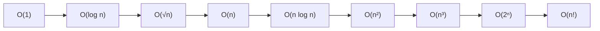

# What Big-O Really Means

> **Level:** Easy · **Part 1 of 8** in Time & Space Complexity
>
> **TL;DR**: Big-O doesn't measure seconds. It answers one question: **"if the input gets bigger, how fast does the work grow?"** Keep the fastest-growing term, drop constants, and compare the result with the constraints: about **10⁸ simple operations per second**.

---

## The idea in plain English

You're looking for a friend's name:

- In a **shuffled stack of 1,000 cards**, you might have to check every card. Twice as many cards → twice the work. That's **O(n)**: work grows in a straight line with n.
- In a **phone book** (sorted), you open the middle, decide "left half or right half", and repeat. 1,000 names take about 10 looks; 1,000,000 names take about 20. Doubling the book adds just **one** look. That's **O(log n)**.
- Comparing **every card with every other card** (to find duplicates by brute force): 1,000 cards → about 500,000 comparisons. Twice the cards → **four** times the work. That's **O(n²)**.

Big-O ignores the speed of your laptop and the exact number of steps. It's about the **shape of growth**, because for big inputs the shape is all that matters.

---

## Why we drop constants and smaller terms

Suppose your code does exactly `3n² + 5n + 100` steps.

| n | `3n²` | `5n` | `100` | share of `3n²` |
|---|---|---|---|---|
| 10 | 300 | 50 | 100 | 67% |
| 1,000 | 3,000,000 | 5,000 | 100 | 99.8% |
| 1,000,000 | 3 × 10¹² | 5 × 10⁶ | 100 | ~100% |

As n grows, the `n²` term swallows everything else. And the constant 3 doesn't change the *shape*: doubling n still quadruples the work. So we write **O(n²)**.

Rules that follow:

| Expression | Big-O | Why |
|---|---|---|
| `5n + 3` | O(n) | drop constants |
| `n² + n log n + n` | O(n²) | keep the fastest-growing term |
| `n / 2` | O(n) | halving is still linear |
| `log₂ n`, `log₁₀ n`, `ln n` | O(log n) | they differ only by a constant factor, so the base doesn't matter |
| `2ⁿ` vs `3ⁿ` | different! | in an exponent the base **does** matter: 3ⁿ / 2ⁿ = 1.5ⁿ is not a constant |
| `n + m` (two inputs) | O(n + m) | don't merge different inputs into one n |
| `1000000` | O(1) | any fixed amount, however big |

---

## The growth table you should know by heart

Assume roughly **10⁸ simple operations per second** (true for C++ and Java once the JIT has warmed up).

| Big-O | Name | Typical source | Ops at n = 10⁵ | Time at n = 10⁵ |
|---|---|---|---|---|
| O(1) | constant | formula, array index, hash lookup | 1 | instant |
| O(log n) | logarithmic | binary search, balanced tree, heap op | ~17 | instant |
| O(√n) | square root | divisors, primality by trial division | ~316 | instant |
| O(n) | linear | one pass | 10⁵ | 1 ms |
| O(n log n) | linearithmic | sorting, n heap operations | ~1.7 × 10⁶ | ~17 ms |
| O(n²) | quadratic | two nested loops | 10¹⁰ | ~100 s (too slow) |
| O(n³) | cubic | three nested loops | 10¹⁵ | ~4 months (too slow) |
| O(2ⁿ) | exponential | all subsets | — | only n ≤ ~25 |
| O(n!) | factorial | all permutations | — | only n ≤ ~11 |

## Read the constraints, then pick the target

| Max n | Allowed complexity | Typical approach |
|---|---|---|
| n ≤ 10–11 | O(n!), O(n! · n) | permutations, brute force |
| n ≤ 20–25 | O(2ⁿ · n) | subsets, bitmask DP, backtracking |
| n ≤ 100–500 | O(n³) | 3 nested loops, interval DP, Floyd–Warshall |
| n ≤ 10³–5 × 10³ | O(n²) | 2D DP, all pairs |
| n ≤ 10⁵–10⁶ | O(n log n) | sorting, binary search, heap, segment tree |
| n ≤ 10⁷–10⁸ | O(n) | single pass, two pointers, sieve |
| n ≥ 10⁹ (a single value) | O(√n), O(log n), O(1) | math, binary search on the answer |

**How to use it:** multiply your complexity by the max n. If it's under ~10⁸ × (time limit in seconds), you're fine. `n = 10⁵` with O(n²) gives 10¹⁰: too slow, so the intended solution is O(n log n) or better. **Constraints are a hint from the problem setter.**

---

## The formal definitions (what interviewers mean)

| Notation | Means | Plain English |
|---|---|---|
| f(n) = **O**(g(n)) | there are constants c, n₀ with f(n) ≤ c · g(n) for all n ≥ n₀ | **upper bound**: grows *no faster* than g |
| f(n) = **Ω**(g(n)) | f(n) ≥ c · g(n) for large n | **lower bound**: grows *at least* as fast as g |
| f(n) = **Θ**(g(n)) | both O and Ω | **tight bound**: grows *exactly* like g |

Technically, binary search is also O(n²) (an upper bound doesn't have to be tight), but nobody says that. In interviews and in these notes, "O" means the **tightest** upper bound you can prove.

## Best, average, worst case (and three other words that sound alike)

| Term | Meaning | Example |
|---|---|---|
| **Worst case** | the most work over all inputs of size n | linear search: target is last or missing → O(n) |
| **Best case** | the least work | linear search: target is first → O(1) (rarely useful) |
| **Average case** | expected work over a *distribution of inputs* | quicksort on random input → O(n log n) |
| **Expected** (randomised) | expected work over the algorithm's *own random choices*, for every input | randomised quickselect → O(n) expected |
| **Amortised** | total work over a *sequence* of operations, divided by the count. A guarantee, no randomness | `ArrayList.add` → O(1) amortised ([Amortized Analysis](/notes/cx-amortized)) |
| **High-probability** | the bound holds except with tiny probability | hashing with a random seed |

Unless stated otherwise, give the **worst case**, and say "amortised" or "expected" when that's what you mean (e.g. "HashMap get is O(1) expected").

---

## Combining pieces

| Code shape | Rule | Example |
|---|---|---|
| one block after another | **add**, keep the biggest | sort O(n log n) then scan O(n) → O(n log n) |
| one block inside a loop | **multiply** | loop n times × O(log n) work → O(n log n) |
| `if / else` | take the **worse** branch | O(1) or O(n) → O(n) |
| calling a method | add **its** cost, don't count it as 1 | `list.contains(x)` inside a loop → O(n) × O(n) |
| recursion | (number of calls) × (work per call), or a recurrence | see [Recursion & Recurrences](/notes/cx-recursion) |

## Space works the same way

Space complexity measures **extra memory** as n grows: arrays you allocate, collections, the recursion stack. Same notation, same rules. Details in [Space Complexity](/notes/cx-space).

---

## Path through this section (easy → hard)

| # | Note | Level |
|---|---|---|
| 1 | What Big-O Really Means (this note) | Easy |
| 2 | [Counting Loops](/notes/cx-loops) | Easy |
| 3 | [Space Complexity](/notes/cx-space) | Easy |
| 4 | [Recursion & Recurrences](/notes/cx-recursion) | Medium |
| 5 | [Amortized Analysis](/notes/cx-amortized) | Medium |
| 6 | [Cheat Sheet: Algorithms & Collections](/notes/cx-cheatsheet) | Medium |
| 7 | [Hidden Costs in Java](/notes/cx-java-costs) | Hard |
| 8 | [Hard & Unusual Cases](/notes/cx-hard-cases) | Hard |

**Next:** [2. Counting Loops](/notes/cx-loops)
