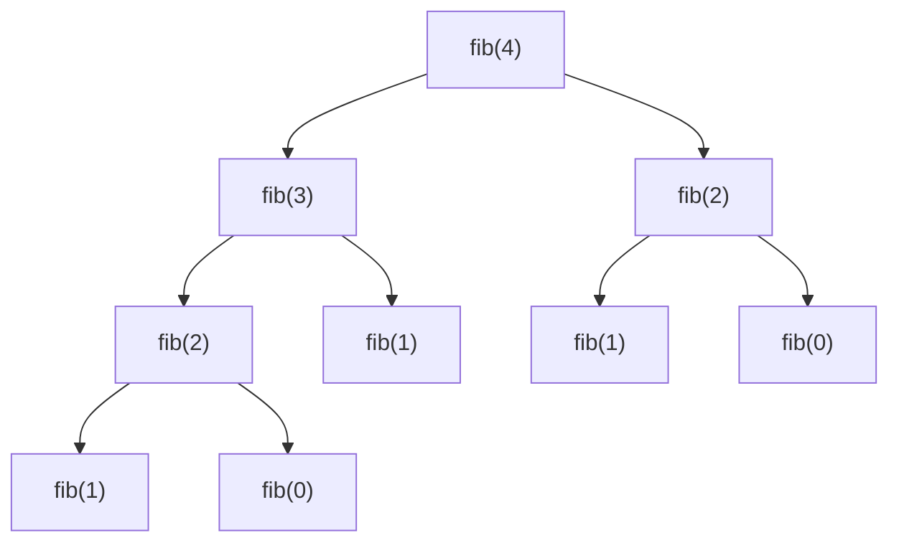

# Space Complexity

> **Level:** Easy · **Part 3 of 8** in Time & Space Complexity
>
> **TL;DR**: space complexity = how much **extra** memory your algorithm needs as n grows. Count new arrays and collections, the **recursion stack depth** (not the number of calls), and copies of strings. In Java, also know the byte costs: `int` 4, `Integer` 16, `int[n]` ≈ 4n, and 256 MB ≈ 6 × 10⁷ ints.

---

## In plain English

Time complexity is "how long does the work take". Space complexity is "**how much scratch paper** do I need while working".

- Reversing an array by swapping the two ends inward: a couple of variables. **O(1) space**, however big the array.
- Copying the array into a new reversed array: one new sheet the size of the input. **O(n) space**.
- Filling an n × m DP table: **O(n · m) space**.

---

## What counts

| Counts toward space | Example | Space |
|---|---|---|
| fixed number of variables | `int i, j, sum` | O(1) |
| a new array / collection of size k | `new int[n]`, `new HashMap<>()` with n entries | O(k) |
| **recursion stack** | each active call keeps a frame until it returns | O(max depth) |
| strings you build | `s.substring(...)`, `sb.toString()`, `s + t` | O(length) each |
| objects in a collection | a queue holding up to V nodes in BFS | O(V) |

**Auxiliary vs total space.** *Auxiliary* = extra memory beyond the input. *Total* = input + auxiliary. When people say "O(1) space", they mean auxiliary. The **output** is usually not counted either ("O(1) extra space besides the answer"), but say so when it matters.

A useful sanity rule: an algorithm can't use more memory than its running time, because touching each cell takes at least one step. If you claim O(n²) space with O(n) time, something's off.

---

## Recursion: depth, not calls

Each call puts a **stack frame** (its parameters and local variables) on the call stack, and that frame stays there until the call returns. So the memory used at any moment is the **current depth** of the recursion, not the total number of calls ever made.

```java
int fib(int n) {
    if (n < 2) return n;
    return fib(n - 1) + fib(n - 2);
}
```

- **Time:** about 2ⁿ calls in total → O(2ⁿ).
- **Space:** the deepest chain is fib(n) → fib(n−1) → … → fib(1): n frames. When one branch finishes, its frames are popped before the other branch starts. → **O(n)**.



9 calls, but at most 4 frames (`fib(4) → fib(3) → fib(2) → fib(1)`) exist at the same time.

| Recursion | Depth | Stack space |
|---|---|---|
| factorial, linked-list recursion | n | O(n) |
| binary search (recursive) | log n | O(log n) |
| merge sort | log n | O(log n) stack + O(n) temp arrays = **O(n)** |
| quicksort | log n average, **n worst** | O(log n) avg, O(n) worst |
| DFS on a balanced tree | log n | O(log n) |
| DFS on a skewed tree / linked-list-like graph | n | O(n) |
| backtracking over n choices | n | O(n) + the current path |

### StackOverflowError in Java

The default thread stack is usually 512 KB–1 MB, which allows roughly **10⁴ to 10⁵ frames** depending on frame size. A DFS on a path graph with 10⁵ or 10⁶ nodes can crash. Fixes:

```java
// 1. Make it iterative with an explicit ArrayDeque stack (heap memory, no limit but RAM).

// 2. Run the solution in a thread with a bigger stack (common in competitive programming)
public static void main(String[] args) throws InterruptedException {
    Thread t = new Thread(null, () -> solve(), "solver", 1 << 27);   // 128 MB stack
    t.start();
    t.join();
}
```

Java does **not** optimise tail calls, so even "tail-recursive" code uses O(depth) stack.

---

## Common space costs

| Algorithm / structure | Extra space |
|---|---|
| two pointers, in-place reverse, Dutch flag | O(1) |
| `Arrays.sort(int[])` | O(log n) typical (quicksort stack) |
| `Arrays.sort(Object[])`, `Collections.sort` | O(n) (TimSort merge buffer) |
| merge sort | O(n) |
| hash map / set of n items | O(n) |
| prefix sums | O(n) |
| BFS | O(V) for the queue and visited array |
| DFS | O(V) for visited + O(depth) stack |
| adjacency list | O(V + E) |
| adjacency matrix | O(V²) |
| 2D DP table n × m | O(n · m), often reducible to O(m) |
| memoised recursion | O(number of states) + O(depth) |
| all subsets / permutations as output | O(2ⁿ · n) / O(n! · n) for the output itself |
| trie of total length L | O(L · alphabet) with arrays, O(L) with maps |

---

## Trading space for time (and back)

| Trade | Example |
|---|---|
| more space → less time | a `HashSet` turns O(n²) duplicate checking into O(n) time, O(n) space |
| more space → less time | memoisation turns O(2ⁿ) Fibonacci into O(n) time, O(n) space |
| more space → less time | prefix sums: O(n) extra space, then any range sum in O(1) |
| less space, same time | rolling arrays in DP: keep only the rows you need |
| less space → more time | sort in place, then two pointers, instead of a hash set |

### Rolling array: O(n · m) → O(m) space

Most DP rows only depend on the previous row, so two rows are enough:

```java
int lcs(String a, String b) {
    int n = a.length(), m = b.length();
    int[] prev = new int[m + 1], cur = new int[m + 1];
    for (int i = 1; i <= n; i++) {
        for (int j = 1; j <= m; j++)
            cur[j] = a.charAt(i - 1) == b.charAt(j - 1) ? prev[j - 1] + 1 : Math.max(prev[j], cur[j - 1]);
        int[] t = prev; prev = cur; cur = t;      // swap rows, no copying
    }
    return prev[m];
}
```

Same O(n · m) time, but O(m) space instead of O(n · m). (You lose the ability to reconstruct the actual subsequence, which needs the full table.)

---

## Java memory in bytes (64-bit JVM, compressed references: the default)

| Thing | Size |
|---|---|
| `byte`, `boolean` (in an array) | 1 |
| `char`, `short` | 2 |
| `int`, `float`, reference | 4 |
| `long`, `double` | 8 |
| object header | 12, rounded up to a multiple of 8 |
| `Integer`, `Long` object | 16, 24 |
| `int[n]` | 16 + 4n |
| `long[n]` | 16 + 8n |
| `String` of n ASCII chars (Java 9+) | ~40 + n |
| `ArrayList<Integer>` per element | ~20 (slot + `Integer`) |
| `HashMap<Integer, Integer>` per entry | ~70 |

### What fits in a memory limit

| Limit | `int`s | `long`s |
|---|---|---|
| 64 MB | ~1.6 × 10⁷ | ~8 × 10⁶ |
| 256 MB | ~6.7 × 10⁷ | ~3.3 × 10⁷ |

- `int[10⁷]` = 40 MB, `long[10⁷]` = 80 MB, `boolean[10⁸]` = 100 MB.
- `int[5000][5000]` = 25 × 10⁶ ints = **100 MB**: often too much. Look for a rolling array.
- **`int[n][2]` vs `int[2][n]`**: Java 2D arrays are arrays of arrays. `int[10⁶][2]` creates a million tiny arrays of 24 bytes each (16 header + 8 data): ~28 MB. `int[2][10⁶]` is two big arrays: ~8 MB. Same data, 3.5x the memory.
- A `HashMap<Integer, Integer>` with 10⁶ entries is ~70 MB; an `int[]` indexed by key is 4 MB if the keys are small.

---

## Pitfalls

- **Forgetting the recursion stack.** "My DFS uses O(1) space" is wrong; it's O(depth).
- **Counting total calls as space.** Fibonacci's 2ⁿ calls use O(n) stack.
- **Hidden copies.** `s.substring(1)` in each recursive call copies the string: O(n²) total memory over a chain of n calls.
- **Storing all paths** in backtracking when you only need a count.
- **Allocating inside a loop** (`new int[n]` per iteration) costs O(n) time each, even if the GC reclaims the memory.

**Next:** [4. Recursion & Recurrences](/notes/cx-recursion)
