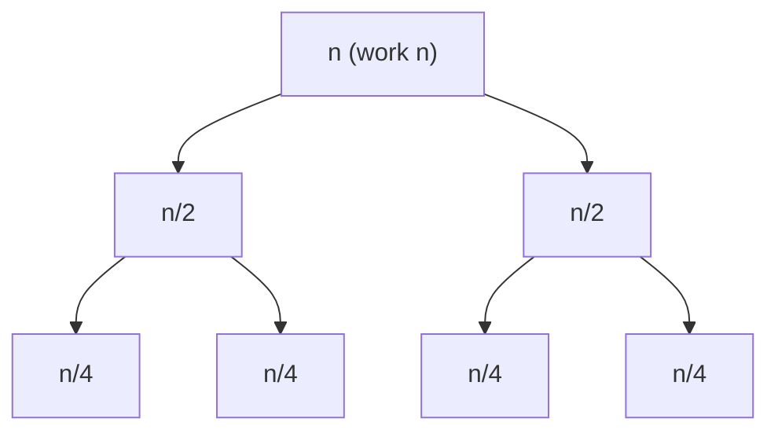

# Recursion & Recurrences

> **Level:** Medium · **Part 4 of 8** in Time & Space Complexity
>
> **TL;DR**: total time = **sum of the work done in every call**. Draw the recursion tree and add it up level by level, or write a recurrence like `T(n) = 2T(n/2) + n` and solve it (Master theorem for "divide" recurrences, unrolling for "subtract" ones). For memoised recursion: **number of distinct states × work per state**.

---

## In plain English

A recursive function is a manager who splits a job and hands the pieces to assistants, who split them further. To know the total effort, you add up what **every person in the org chart** does:

- How many people are there? (number of calls)
- How much does each person do *themselves*, not counting what they hand off? (work per call)
- How deep is the chart? (recursion depth → stack space)

---

## Method 1: the recursion tree

Draw the calls as a tree. For each level, write the total work done at that level, then add the levels.

### Merge sort: `T(n) = 2T(n/2) + n`



| Level | Calls | Size of each | Work at this level |
|---|---|---|---|
| 0 | 1 | n | n |
| 1 | 2 | n/2 | 2 · n/2 = n |
| 2 | 4 | n/4 | 4 · n/4 = n |
| … | … | … | n |
| log₂ n | n | 1 | n |

Every level does n work, and there are log₂ n + 1 levels → **O(n log n)**.

### Fibonacci: `T(n) = T(n-1) + T(n-2) + 1`

Each call makes two more, and the tree is about n levels deep, so at most 2ⁿ calls, each doing O(1) → **O(2ⁿ)**. (Tight bound: O(φⁿ) with φ ≈ 1.618, because the right branch is shorter than the left.)

### Binary search: `T(n) = T(n/2) + 1`

One call per level, log₂ n levels, O(1) each → **O(log n)**.

---

## Method 2: unrolling ("subtract" recurrences)

When the size goes down by a constant (`n − 1`), expand the recurrence a few times and spot the sum.

```
T(n) = T(n-1) + n
     = T(n-2) + (n-1) + n
     = T(n-3) + (n-2) + (n-1) + n
     = 1 + 2 + ... + n  =  n(n+1)/2   →   O(n²)
```

| Recurrence | Result | Where it shows up |
|---|---|---|
| `T(n) = T(n-1) + 1` | O(n) | factorial, linked-list recursion, sum of an array |
| `T(n) = T(n-1) + n` | O(n²) | recursive selection sort, **quicksort's worst case** |
| `T(n) = T(n-1) + log n` | O(n log n) | inserting into a heap/tree one by one |
| `T(n) = 2T(n-1) + 1` | O(2ⁿ) | Tower of Hanoi, naive "include / exclude" |
| `T(n) = T(n-1) + T(n-2) + 1` | O(φⁿ) ≈ O(1.618ⁿ) | naive Fibonacci |
| `T(n) = n · T(n-1)` | O(n!) | generating permutations |

Rule of thumb for "subtract" recurrences: **one** recursive call → a polynomial (multiply f(n) by n). **Two or more** calls → exponential (`aⁿ`).

---

## Method 3: the Master theorem ("divide" recurrences)

For recurrences of the form

```
T(n) = a · T(n / b) + f(n)        a ≥ 1 subproblems, each of size n/b, plus f(n) work to split/combine
```

compute the **critical exponent** `c* = log_b(a)`. The tree has `n^c*` leaves. Then compare f(n) with `n^c*`:

| Case | Condition | Result | Plain English |
|---|---|---|---|
| 1 | f(n) = O(n^c) with **c < c\*** | **Θ(n^c\*)** | the leaves dominate: work grows going down the tree |
| 2 | f(n) = Θ(n^c\* · logᵏ n), k ≥ 0 | **Θ(n^c\* · logᵏ⁺¹ n)** | every level does about the same work: multiply by the number of levels |
| 3 | f(n) = Ω(n^c) with **c > c\*** (and `a·f(n/b) ≤ k·f(n)` for some k < 1) | **Θ(f(n))** | the root dominates: work shrinks going down the tree |

### Worked examples

| Recurrence | a, b | c* = log_b a | f(n) | Case | Result | Algorithm |
|---|---|---|---|---|---|---|
| `T(n/2) + 1` | 1, 2 | 0 | 1 | 2 | O(log n) | binary search |
| `2T(n/2) + 1` | 2, 2 | 1 | 1 | 1 | O(n) | recursive tree traversal, building a segment tree |
| `2T(n/2) + n` | 2, 2 | 1 | n | 2 | O(n log n) | merge sort |
| `2T(n/2) + n log n` | 2, 2 | 1 | n log n | 2 (k=1) | O(n log² n) | divide & conquer that sorts at each level |
| `T(n/2) + n` | 1, 2 | 0 | n | 3 | O(n) | quickselect with good pivots |
| `2T(n/2) + n²` | 2, 2 | 1 | n² | 3 | O(n²) | |
| `3T(n/2) + n` | 3, 2 | ≈1.585 | n | 1 | O(n^1.585) | Karatsuba multiplication |
| `4T(n/2) + n` | 4, 2 | 2 | n | 1 | O(n²) | naive divide & conquer multiplication |
| `7T(n/2) + n²` | 7, 2 | ≈2.807 | n² | 1 | O(n^2.807) | Strassen matrix multiplication |
| `8T(n/2) + n²` | 8, 2 | 3 | n² | 1 | O(n³) | naive divide & conquer matrix multiplication |

### When the Master theorem does NOT apply

- The size shrinks by **subtraction** (`T(n-1)`): use unrolling.
- The parts are **unequal** (`T(n/3) + T(2n/3) + n`): use a recursion tree (answer: O(n log n), see [Hard & Unusual Cases](/notes/cx-hard-cases)).
- f(n) falls **between** cases, e.g. `2T(n/2) + n / log n` (answer: O(n log log n)).
- `a` isn't a constant (`T(n) = n · T(n/2)`).

---

## Method 4: memoised recursion and DP

With memoisation, each distinct input is computed **once**. So:

```
time  = (number of distinct states) × (work per state, treating recursive calls as O(1) lookups)
space = (number of states stored) + (max recursion depth)
```

| Problem | States | Work per state | Time |
|---|---|---|---|
| Fibonacci (memo) | n | O(1) | O(n) |
| Climbing stairs / house robber | n | O(1) | O(n) |
| Unique paths in an m × n grid | m · n | O(1) | O(m · n) |
| Coin change (amount A, k coins) | A | O(k) | O(A · k) |
| Longest increasing subsequence (DP) | n | O(n) | O(n²) |
| LCS / edit distance | n · m | O(1) | O(n · m) |
| Matrix chain / burst balloons (interval DP) | n² | O(n) | O(n³) |
| 0/1 knapsack (capacity W) | n · W | O(1) | O(n · W) |
| Travelling salesman (bitmask) | 2ⁿ · n | O(n) | O(2ⁿ · n²) |

The same Fibonacci code goes from O(2ⁿ) to O(n) just by caching: the tree of calls collapses into a chain because every repeated subtree is now a single lookup.

---

## Method 5: backtracking: count the nodes of the search tree

Time = (nodes in the recursion tree) × (work per node) + (work at the leaves, e.g. copying the answer).

| Problem | Leaves | Work per leaf | Time |
|---|---|---|---|
| all subsets | 2ⁿ | O(n) copy | O(n · 2ⁿ) |
| all permutations | n! | O(n) copy | O(n · n!) |
| combinations of size k | C(n, k) | O(k) copy | O(k · C(n, k)) |
| N-Queens (with pruning) | ≤ n! | O(n) | O(n!) upper bound, far less in practice |
| Word search in an m × n board, word length L | m · n starts × 3ᴸ paths | O(1) | O(m · n · 3ᴸ) |
| generate valid parentheses (n pairs) | Catalan(n) ≈ 4ⁿ / n^1.5 | O(n) | O(4ⁿ / √n) |

For subsets: the tree has 2ⁿ leaves and 2ⁿ⁺¹ − 1 nodes in total (a full binary tree has fewer internal nodes than leaves), so the leaves set the order of growth.

---

## Space of recursion

```
space = max depth × (space per frame) + any data structures you build
```

| Function | Depth | Space |
|---|---|---|
| merge sort | log n | O(n) (the temp arrays dominate the O(log n) stack) |
| quicksort | log n average, n worst | O(log n) average, O(n) worst (recurse on the smaller half first to guarantee O(log n)) |
| naive Fibonacci | n | O(n), despite O(2ⁿ) time |
| memoised Fibonacci | n | O(n) memo + O(n) stack |
| subsets / permutations | n | O(n) besides the output |

**Next:** [5. Amortized Analysis](/notes/cx-amortized)
